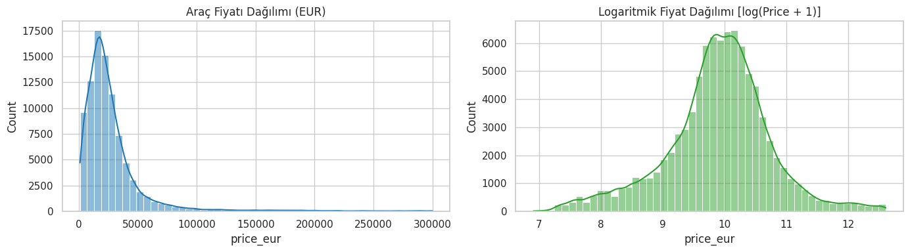
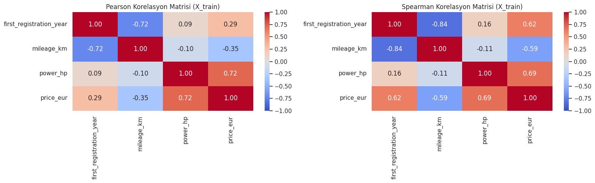
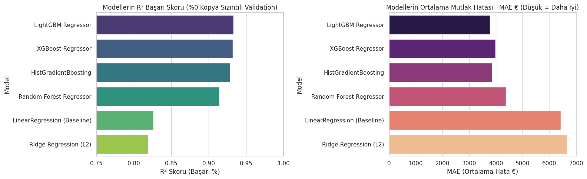
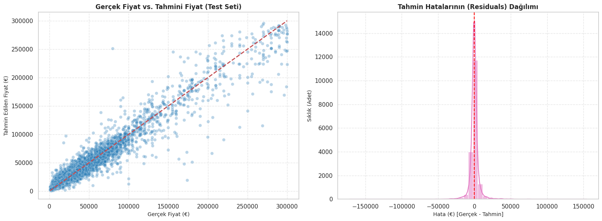
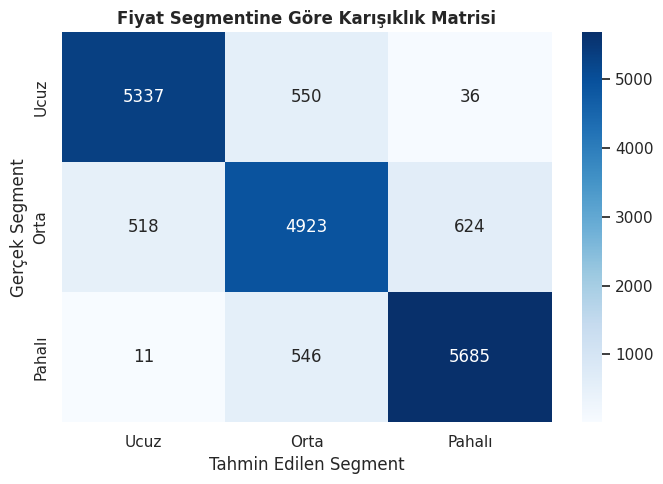
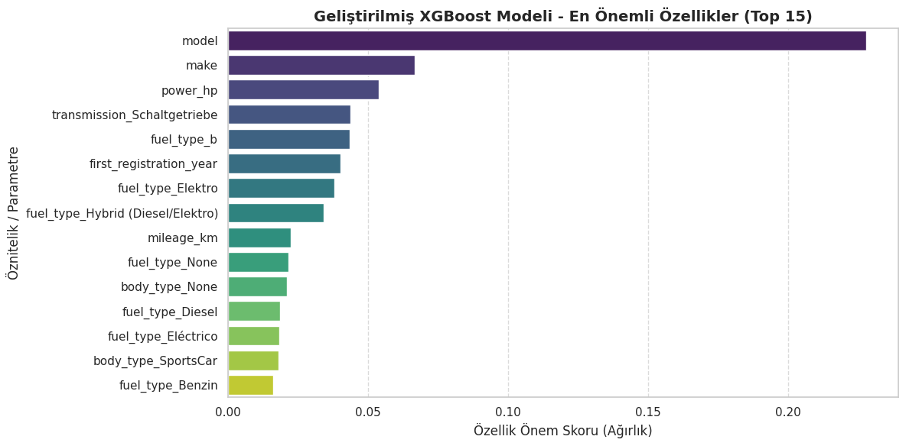

# 🚗 Avrupa İkinci El Araç Fiyat Tahmin Sistemi
**BTK Akademi — Uçtan Uca Makine Öğrenmesi Projesi**

Bu proje, Avrupa ikinci el otomobil piyasasından derlenen **100.000 araç ilanı** üzerinde uçtan uca, tekrarlanabilir (`random_state=42`) ve **%0 veri sızıntılı (Zero Data Leakage)** bir regresyon hattı kurarak araçların adil piyasa değerini (`price_eur`) tahmin eder.

📄 **Tam Teknik Rapor (PDF):** [Avrupa_Ikinci_El_Arac_Fiyat_Tahmini_Teknik_Rapor.pdf](./Avrupa_Ikinci_El_Arac_Fiyat_Tahmini_Teknik_Rapor.pdf)  
📓 **Deney Notebook Dosyası:** [Avrupa_Ikinci_El_Arac_Fiyat_Tahmini_BTK_Final.ipynb](./Avrupa_Ikinci_El_Arac_Fiyat_Tahmini_BTK_Final.ipynb)

---

## 📌 1. Problem Tanımı ve Motivasyon
İkinci el araç piyasasında fiyat; aracın yaşı ile kilometresi arasındaki doğrusal olmayan yıpranma etkisi, marka-model prestiji, motor gücü, vites/yakıt tipi ve ülke bazlı pazar dinamikleri nedeniyle karmaşık bir yapıya sahiptir. Bu sistem, bireysel alıcı/satıcıların ve galerilerin 9 temel araç parametresiyle saniyeler içinde piyasa fiyatını öğrenmesini sağlar.

- **Hedef Değişken:** `price_eur` (Euro cinsinden ilan fiyatı)
- **Öncelikli Metrik:** **MAE (€)** (Kullanıcı için doğrudan Euro cinsinden yorumlanabilir ortalama sapma)
- **Destekleyici Metrikler:** **R²**, **RMSE (€)**, **MAPE (%)**, **MdAPE (Medyan %)** ve **±%15 Tolerans İçi Başarı Oranı**

---

## 📊 2. Veri Seti, Kalite Kontrolü ve %0 Sızıntı Mimarisi
- **Kaynak:** [Kaggle — European Used Car Market Dataset (100K Listings)](https://www.kaggle.com/datasets/automarketapicom/european-used-car-market-dataset-100k-listings)
- **Veri Temizliği Özeti:**
  1. **Sızıntı ve Gizlilik Temizliği:** Hedef fiyatla doğrudan ilişkili `price_evaluation` (veri sızıntısı), `%57,45` eksik veriye sahip `color`, `power_kw` (`power_hp` kopyası) ve kişisel/satıcı kimlik sütunları (`id`, `seller_name`, `seller_zip` vb.) çıkarılmıştır.
  2. **Aykırı Değer (Outlier) Filtresi:** Model yılı `1995–2026`, motor gücü `11–850 HP`, kilometre `0–500.000 km` ve fiyat `1.000–500.000 €` dışındaki `1.552 (%1,55)` hatalı kayıt elenmiştir.
  3. **Gizli Kopyaların (Hidden Duplicates) Tekilleştirilmesi:** `id` silindikten sonra 9 girdi özelliği birebir aynı olan **7.302 gizli kopya**, veri bölünmesinden **önce** tekilleştirilmiş ve **91.146 benzersiz araç** elde edilmiştir.
  4. **Üçlü Veri Bölme (`random_state=42`):**
     - **Train (%60):** `54.687` araç (Train-Val ve Train-Test satır örtüşmesi: **%0,00**)
     - **Validation (%20):** `18.229` araç (Model karşılaştırma ve hiperparametre seçimi)
     - **Test (%20):** `18.230` araç (Yalnızca final modelin tek seferlik nihai değerlendirmesi)




---

## 🏆 3. Baseline, Model Karşılaştırması ve Hiperparametre Optimizasyonu

### 3.1 İlk Model Karşılaştırması (Validation Seti — 18.229 Araç)
| Sıra | Model / Algoritma | Rolü | Validation R² | Validation MAE (€) | Validation RMSE (€) | Eğitim Süresi |
| :---: | :--- | :--- | :---: | :---: | :---: | :---: |
| 1 | **LightGBM Regressor** | Güçlü Rakip 1 | **%93,34** | **3.773,75 €** | **7.851,95 €** | 1,94 sn |
| 2 | **XGBoost Regressor** | Aday Model | %93,20 | 3.987,18 € | 7.931,81 € | 10,19 sn |
| 3 | **HistGradientBoosting** | Güçlü Rakip 2 | %92,88 | 3.860,28 € | 8.119,65 € | 40,18 sn |
| 4 | Random Forest Regressor | Karşılaştırma | %91,44 | 4.371,14 € | 8.901,60 € | 23,72 sn |
| 5 | LinearRegression | **Baseline 2** | %82,60 | 6.421,53 € | 12.691,95 € | 7,53 sn |
| 6 | Ridge Regression (L2) | Karşılaştırma | %81,93 | 6.667,04 € | 12.933,57 € | 1,46 sn |
| 7 | DummyRegressor (Ortalama) | **Baseline 1** | %0,00 | 17.162,35 € | 30.426,09 € | 0,37 sn |



### 3.2 Hiperparametre Optimizasyonu (`RandomizedSearchCV` — Validation Sonuçları)
| Model | Rol | Tuning Öncesi R² | Tuning Sonrası R² | Tuning Öncesi MAE | Tuning Sonrası MAE |
| :--- | :--- | :---: | :---: | :---: | :---: |
| **Optimize XGBoost** | **Seçilen Final Model** | %93,20 | **%93,89 (+0,69%)** | 3.987,18 € | **3.621,50 € (-365,68 €)** |
| Optimize HistGradientBoosting | Güçlü Rakip 2 | %92,88 | %92,98 (+0,10%) | 3.860,28 € | 3.742,50 € (-117,78 €) |
| Optimize LightGBM | Güçlü Rakip 1 | %93,34 | %93,38 (+0,04%) | 3.773,75 € | 3.757,37 € (-16,38 €) |

---

## 🎯 4. Final Model Test Seti Performansı ve Hata Analizi (18.230 Araç)
- **Nihai Test R² Skoru:** `%94,03` (One-Hot Pipeline) / `%93,71` (TargetEncoder Pipeline)
- **Nihai Test MAE:** `3.535,19 € – 3.627,27 €`
- **Medyan Mutlak Yüzde Hata (MdAPE):** `%9,27 – %10,01`
- **±%15 Tolerans İçi Başarı:** `%66,69 – %68,47`
- **Fiyat Segmenti (Ucuz / Orta / Pahalı) Sınıflandırma Doğruluğu:** `%87,47` (Macro F1: `0,8745`)





---

## 🚀 5. Kurulum ve Çalıştırma Talimatları

### 5.1 Depoyu Klonlama ve Bağımlılıkları Yükleme
```bash
git clone https://github.com/BurakGuldal10/Avrupa-Ikinci-El-Arac-Fiyat-Tahmini.git
cd Avrupa-Ikinci-El-Arac-Fiyat-Tahmini
pip install -r requirements.txt
```

### 5.2 Modeli Sıfırdan Eğitme (`final_model.joblib` Üretimi)
```bash
python train.py
```

### 5.3 Gradio Web Arayüzünü Başlatma
```bash
python app.py
```
Komut çalıştığında yerel sunucu (`http://127.0.0.1:7860`) üzerinden etkileşimli fiyat tahmin arayüzüne erişebilirsiniz.

---

## 📁 6. Depo Dosya Yapısı
```text
├── Avrupa_Ikinci_El_Arac_Fiyat_Tahmini_BTK_Final.ipynb   # Uçtan uca 15 aşamalı Jupyter/Colab Notebook
├── Avrupa_Ikinci_El_Arac_Fiyat_Tahmini_Teknik_Rapor.pdf  # 15 sayfalık resmî BTK Teknik Raporu (PDF)
├── app.py                                                # Doğrulama ve uyarı destekli Gradio arayüzü
├── train.py                                              # Tekrarlanabilir model eğitim betiği
├── requirements.txt                                      # Kütüphane ve ortam gereksinimleri
├── README.md                                             # Proje dokümantasyonu
└── assets/                                               # EDA ve model değerlendirme grafikleri
```
